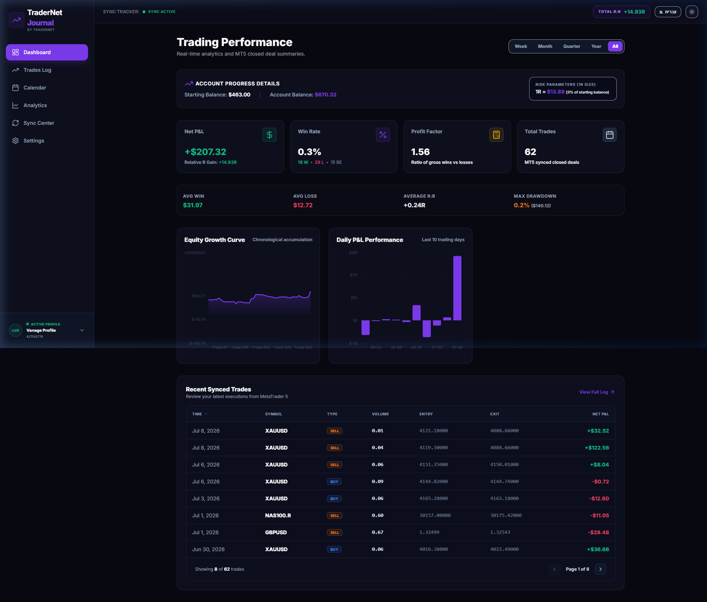
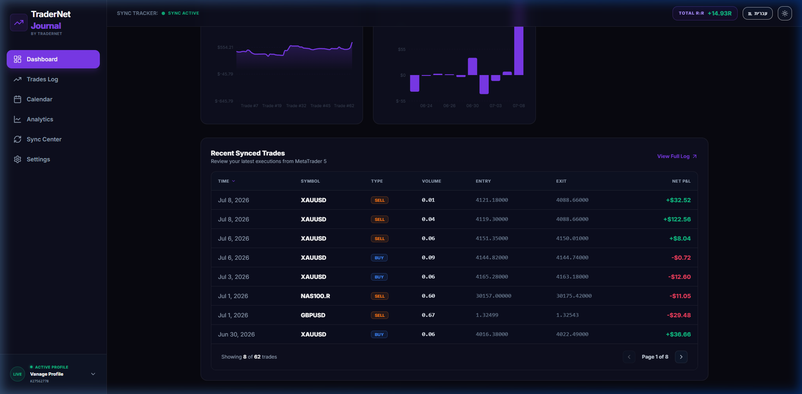
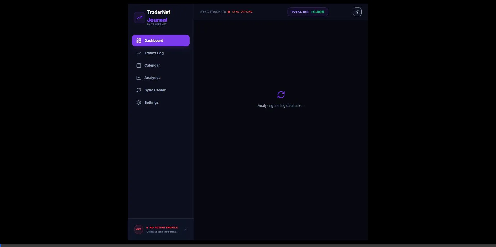

# 📊 MetaTrader 5 Personal Trading Journal & Analytics Dashboard

A premium, modern, and high-fidelity personal trading journal and analytics dashboard designed specifically for day traders executing on **MetaTrader 5 (MT5)**. Inspired by leading analytics platforms like TradeZella, TradesViz, and TraderSync, this local application automatically synchronizes closed trades/deals, compiles them into structured positions in MongoDB, and presents real-time analytics in a fully responsive, SaaS-style React client.

---

## 🏗️ Architecture & System Design

The application consists of three main components running in a local environment:

```
                  ┌────────────────────────────────────────┐
                  │      MetaTrader 5 Desktop (Windows)    │
                  └───────────────────┬────────────────────┘
                                      │
                                      ▼ (Python MetaTrader5 API)
                  ┌────────────────────────────────────────┐
                  │          Python Sync Worker            │
                  │   - Daemon polling every 60 seconds    │
                  │   - Fast-response manual sync trigger  │
                  └───────────────────┬────────────────────┘
                                      │
                                      ▼ (HTTP REST API Import)
                  ┌────────────────────────────────────────┐
                  │       Node.js Express API Server       │
                  │             (TypeScript)               │
                  └───────────────────┬────────────────────┘
                                      │
                                      ▼ (Mongoose ODM)
                  ┌────────────────────────────────────────┐
                  │             MongoDB Atlas              │
                  │       (Database: trading_journal)      │
                  └───────────────────▲────────────────────┘
                                      │
                                      │ (REST Client Fetching)
                  ┌───────────────────┴────────────────────┘
                  │          React SPA Dashboard           │
                  │      (Vite + TS + Tailwind CSS)        │
                  └────────────────────────────────────────┘
```

---

## 📸 Screenshots & Example Output

### 📈 Personal Trading Dashboard & Equity Curve


### 📋 Interactive Trade Ledger & Multi-Sort Filters


### 🎥 Interactive Session Recordings

#### 📊 Pagination & Header Sorting Demo


#### 🔄 Order-Preserved Position Grouping Demo


---

## 🛠️ Complete Technology Stack

The project is built entirely on modern, type-safe languages and scalable libraries:

### 1. Frontend (React Client SPA)
*   **Core Framework:** React 18 (TypeScript)
*   **Build Tool & Dev Server:** Vite
*   **Routing:** React Router DOM v6 (Client-side page navigation)
*   **Data Visualization:** Recharts (High-performance SVG charts for equity curve, drawdowns, and daily distributions)
*   **Icons:** Lucide React
*   **Styling:** Tailwind CSS (Curated SaaS dark mode UI, glassmorphic card overlays, responsive layouts)

### 2. Backend (Node.js REST API)
*   **Runtime:** Node.js
*   **API Framework:** Express.js (TypeScript)
*   **Mongoose ODM:** MongoDB connection, schema validation, indexing, and indexing optimizations
*   **Development Tools:** `ts-node-dev` for fast reload, TypeScript compiler
*   **Validation:** Zod Schema Validation

### 3. Sync Daemon (Python Worker)
*   **Integration Core:** `MetaTrader5` (Desktop terminal connector package)
*   **Data Manipulation:** Pandas (High-speed table manipulation, calculations, date parsing)
*   **HTTP Communication:** Requests (Posting payload array to `/api/trades/import` endpoint)
*   **Configuration:** python-dotenv (Multi-environment configuration support)

---

## ⚡ Key Features

*   **Automated Background Synchronization:** Python worker daemon automatically scans your MT5 account history every 60 seconds and updates your journal.
*   **Manual Override Sync:** Click the "Sync Now" button directly in the React client to trigger an instant synchronization process (worker polls and responds within 5 seconds).
*   **Advanced Trade Aggregation:** Groups raw entry and exit deals into composite Positions using MT5 `position_id` tracking. Computes exit-weighted average prices, net profits, and hold duration.
*   **Interactive Multi-Timeframe Analytics:** Displays dynamic statistics (Win Rate, Profit Factor, Risk-to-Reward, Max Drawdown) computed client-side using custom filters (Week, Month, Quarter, Year, All).
*   **Full Journal Workshop:** Track mental/emotional trade tags (e.g. FOMO, Greedy, Calm), rate executions (1-10), tag mistakes (e.g. Early Exit, Bad Entry), log strategies, write markdown notes, and attach charts before/after execution.
*   **Responsive Multi-Sort Ledger:** Easily sort all closed executions by close date, symbol, trade volume, or net profit in ascending or descending directions.
*   **Monthly Performance Calendar:** A visual grid representation of your trading history. Profits are shown in green, losses in red. Click any calendar date to view the full details of that day's trades.

---

## 🚀 Installation & Getting Started

### 📋 Prerequisites
*   **OS:** Windows (required to run the MetaTrader 5 Terminal and the Python `MetaTrader5` library).
*   **MetaTrader 5 Desktop Client:** Logged in and running on your workstation.
*   **Node.js:** v18 or newer.
*   **Python:** v3.8 or newer.
*   **MongoDB Atlas:** Connection string (or local MongoDB database).

---

### 📦 Step-by-Step Setup

#### 1. Database Setup
1. Log in to [MongoDB Atlas](https://www.mongodb.com/cloud/atlas) or start a local MongoDB server.
2. Create a database called `trading_journal`.
3. Obtain your connection URL string.

---

#### 2. Backend REST API Installation
1. Open a terminal and navigate to the backend folder:
    ```bash
    cd backend
    ```
2. Install the required Node.js packages:
    ```bash
    npm install
    ```
3. Copy `.env.example` to create `.env`:
    ```bash
    cp .env.example .env
    ```
4. Edit the new `.env` and fill in your MongoDB connection details:
    ```env
    PORT=5000
    MONGO_URI=mongodb+srv://<username>:<password>@cluster.mongodb.net/trading_journal?retryWrites=true&w=majority
    CLIENT_URL=http://localhost:5173
    ```
5. **(Optional) Seed Mock Data:** To test the dashboard immediately with 30 days of realistic trading history, run the seeding script:
    ```bash
    npm run seed
    ```
6. Start the API server in development mode:
    ```bash
    npm run dev
    ```
    *The API will start running at [http://localhost:5000](http://localhost:5000).*

---

#### 3. Frontend Dashboard Client Installation
1. Open a separate terminal and navigate to the frontend folder:
    ```bash
    cd frontend
    ```
2. Install Node.js packages:
    ```bash
    npm install
    ```
3. Copy `.env.example` to create `.env`:
    ```bash
    cp .env.example .env
    ```
4. Verify the backend connection URL in `.env`:
    ```env
    VITE_API_URL=http://localhost:5000/api
    ```
5. Start the Vite React development server:
    ```bash
    npm run dev
    ```
    *The dashboard will be active at [http://localhost:5173](http://localhost:5173).*

---

#### 4. Python MT5 Sync Worker Setup
1. Open a separate terminal and navigate to the sync folder:
    ```bash
    cd sync
    ```
2. Install Python dependencies:
    ```bash
    pip install -r requirements.txt
    ```
3. Copy `.env.example` to create `.env` and configure synchronization values:
    ```env
    API_URL=http://localhost:5000/api
    SYNC_INTERVAL_SECONDS=60
    ```
4. Ensure your MetaTrader 5 Terminal is open and running.
5. **Start Auto-Sync daemon (Recommended):**
    ```bash
    python mt5_sync_worker.py
    ```
6. **(Alternative) One-Time Sync:** Runs a single query, imports data, and exits:
    ```bash
    python mt5_sync_once.py
    ```

---

## ⚙️ Advanced Workflows

### Position Aggregation Logic
MetaTrader 5 tracks independent entry and exit deals. This platform automatically groups multiple executions under the same `positionId` (using `groupTradesByPosition`).
*   The first deal marks the starting point, session, and type.
*   Subsequent partial exits are aggregated.
*   The final close time corresponds to the last exit deal.
*   Net profit, volume, and commissions are summed, and the entry/exit prices are dynamically weighted.

### Risk Management & Stop Loss Tracking
During synchronization, the worker references entry order ticket details in MT5 to pull Stop Loss (SL) and Take Profit (TP) points. It then calculates the Risk Gain ratio ($R$) based on the trader's starting capital and risk percentage parameters configured in the settings.

---

## 🔒 Security & Data Privacy
*   **100% Local Data:** Your trading records, notes, and screenshots are stored entirely on your local machine and your private MongoDB Atlas cluster. No trade data is shared.
*   **API Security:** Environment configurations (`.env`) containing MongoDB credentials and server ports are listed in `.gitignore` to prevent accidental public disclosure.
